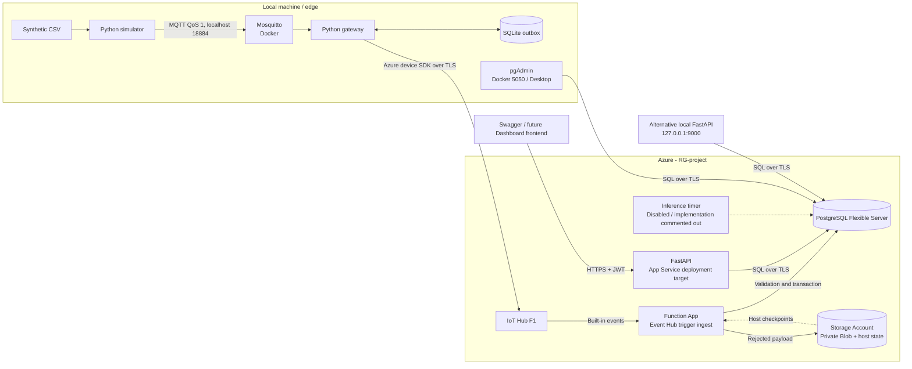
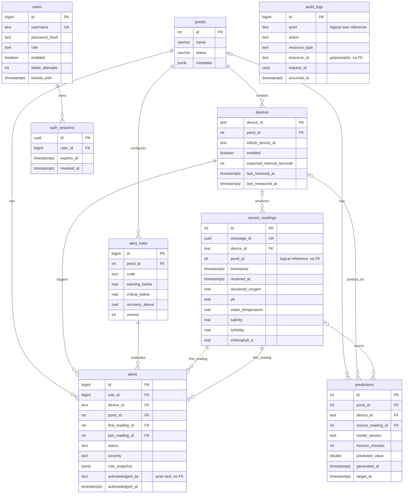

# Architecture, Database, and Infrastructure

### Applications and Data Stores with Deployment Locations

## 2. Database Tables

The final schema consists of `db/schemal.sql` **plus migrations 001–005**, not the
initial schema file alone.

| Table | Data and purpose |
|---|---|
| ponds | Farming units/cages, names, status, and location/description metadata |
| devices | Sensor ID mapped to a pond and Azure gateway ID; enabled flag, reporting interval, latest measurement/receipt times |
| sensor_readings | Six measurements, message UUID, device, pond, timestamp, and received_at |
| alert_rules | Low-DO thresholds per pond: warning, critical, recovery, version, and enabled flag |
| alerts | An abnormal episode, first/last reading evidence, severity, status, acknowledgment, and rule snapshot |
| audit_logs | Actor/action/resource/outcome/request ID; currently records acknowledgment events |
| predictions | Predictions, source readings, model versions, horizons, and timestamps |
| users | Dashboard accounts, Argon2 hashes, roles, enabled flags, failure counters, and temporary locks |
| auth_sessions | Session UUIDs, users, expiry times, and revocation timestamps |

### ERD — Relationships Enforced by SQL Foreign Keys

Only representative columns are shown. Optional relationships reflect nullable
columns retained for legacy records.

**Important distinctions:** `sensor_readings.pond_id` currently has no foreign key
to ponds; ingestion derives it from devices. `audit_logs.actor` and
`alerts.acknowledged_by` store `user:<id>` strings without a users foreign key.
Individual foreign keys do not enforce every device/pond/rule combination; service
code enforces those business mappings. The legacy `predictions.pond_id` foreign key
uses ON DELETE CASCADE, so do not delete ponds casually. The API provides no pond deletion endpoint.

## 4. Infrastructure, Settings, and Credential Responsibilities

| Component | Configuration and purpose |
|---|---|
| Mosquitto in Docker | Local port 18884, username/password and ACLs; bound to loopback only |
| pgAdmin in Docker | Port 5050; administration UI, not the database server |
| Gateway SQLite | `.runtime/outbox.sqlite3`: durable queue, deduplication, and UTC daily sending budget |
| IoT Hub F1 | Device pond-gateway-01; built-in events and fallback routing |
| Function App Flex Consumption | ingest trigger reads events, writes PostgreSQL, and quarantines rejected payloads |
| Storage Account | Host/checkpoint/deployment storage depending on Azure configuration; private telemetry-rejected container |
| Azure PostgreSQL Flexible Server | Application database, public access with firewall rules, TLS verify-full |
| Azure App Service Linux | FastAPI Dashboard API, Python 3.11, separate deployment target from ingestion |

Do not create a separate Event Hubs namespace solely to read IoT Hub's built-in
endpoint. The local API uses port 9000; App Service's built-in Python runtime uses
internal port 8000 and exposes public HTTPS on port 443.

| Location | Settings |
|---|---|
| Edge `.env.local` | MQTT_*, GATEWAY_*, IOTHUB_DEVICE_CONNECTION_STRING |
| Function App | IOTHUB_EVENTS_CONNECTION, IOTHUB_EVENTHUB_NAME, IOTHUB_CONSUMER_GROUP=$Default |
| Function App | QUARANTINE_STORAGE_CONNECTION, QUARANTINE_CONTAINER; host Storage configured during app creation |
| Function App database | PGHOST/PGPORT/PGDATABASE, PGUSER=lobster_ingest, PGPASSWORD, PGSSLROOTCERT |
| App Service/local API | PGHOST/PGPORT/PGDATABASE, API_PGUSER=lobster_api, API_PGPASSWORD, PGSSLROOTCERT |
| App Service/local API | AUTH_JWT_SECRET, AUTH_TOKEN_MINUTES=60, API_ALLOWED_ORIGINS set to the frontend origin |
| App Service build | SCM_DO_BUILD_DURING_DEPLOYMENT=true |
| Disabled Function AI | PREDICTIONS_ENABLED=false, AzureWebJobs.predict_readings.Disabled=true |

The local/API ZIP CA path is `backend/certs/azure-postgresql-roots.pem`. In the
Function artifact it is `/home/site/wwwroot/certs/azure-postgresql-roots.pem`.
The two artifacts place the file differently. `.env.local` is not automatically
uploaded as cloud settings. Do not store PostgreSQL administrator credentials in
the Web App; the management CLI prompts for them separately when provisioning accounts.
