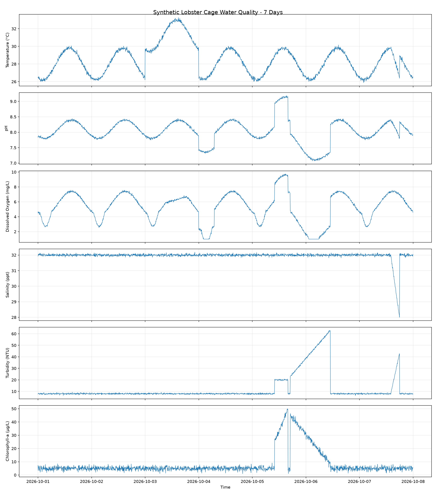
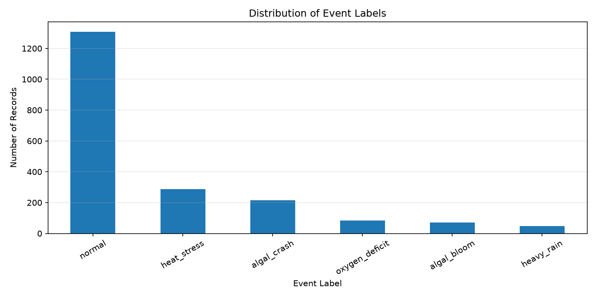
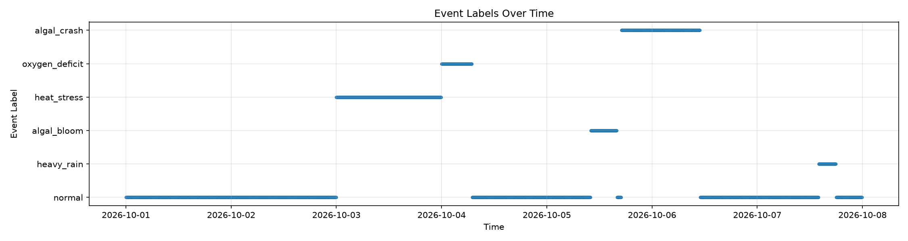

# AIoT-Based Smart Lobster Farming Monitoring System

> **Hệ thống giám sát chất lượng nước nuôi tôm hùm thông minh ứng dụng AI, IoT và Cloud Computing.**
>
> Dự án hướng đến xây dựng nền tảng giám sát môi trường nuôi tôm, phân tích dữ liệu chất lượng nước và hỗ trợ phát hiện sớm các điều kiện bất lợi thông qua trí tuệ nhân tạo.

---

## Table of Contents

1. [Overview](#1-overview)
2. [System Architecture](#2-system-architecture)
3. [Repository Layout](#3-repository-layout)
4. [AI and Data Processing](#4-ai-and-data-processing)
5. [System Workflow](#5-system-workflow)
6. [Requirements](#6-requirements)
7. [Getting Started](#7-getting-started)
8. [Dataset and Demo Results](#8-dataset-and-demo-results)
9. [Known Gaps and Roadmap](#9-known-gaps-and-roadmap)
10. [Authors and Group Roles](#10-authors-and-group-roles)

---

## 1. Overview

### 1.1 Project Description

**AIoT-Based Smart Lobster Farming Monitoring System** là đồ án hướng đến ứng dụng Internet of Things (IoT), Artificial Intelligence (AI) và Cloud Computing trong giám sát môi trường nuôi tôm hùm.

Chất lượng nước là một trong những yếu tố quan trọng ảnh hưởng đến sức khỏe và sự phát triển của tôm. Việc theo dõi các thông số môi trường thường xuyên giúp người nuôi nhận biết những thay đổi bất thường và đưa ra quyết định kịp thời.

Dự án hướng đến xây dựng hệ thống có khả năng thu thập, lưu trữ, trực quan hóa dữ liệu môi trường, kết hợp mô hình AI để hỗ trợ dự đoán và phát hiện các điều kiện chất lượng nước bất lợi.

**Lưu ý:** Phiên bản hiện tại đang trong giai đoạn phát triển. Dataset đã xây dựng là dữ liệu tổng hợp phục vụ thử nghiệm, không phải dữ liệu đo đạc thực tế từ lồng nuôi tôm.

### 1.2 Core Objectives

- **Environmental Monitoring:** Theo dõi các thông số chất lượng nước như nhiệt độ, pH, oxy hòa tan (DO), độ mặn và độ đục.
- **Data Engineering:** Xây dựng pipeline tạo, kiểm tra, phân tích và trực quan hóa dữ liệu.
- **AI-Based Prediction:** Phát triển mô hình dự đoán các thông số chất lượng nước và hỗ trợ nhận diện những điều kiện bất lợi.
- **Cloud Integration:** Định hướng tích hợp dịch vụ Cloud để lưu trữ, xử lý và cung cấp dữ liệu cho ứng dụng.
- **Dashboard Visualization:** Xây dựng giao diện trực quan để theo dõi thông số môi trường, lịch sử và các cảnh báo.

### 1.3 Expected Benefits

- Hỗ trợ theo dõi sự biến động của chất lượng nước.
- Hỗ trợ phát hiện sớm các tình huống môi trường cần chú ý.
- Tạo nền tảng cho việc ứng dụng AI vào quản lý hoạt động nuôi trồng thủy sản.
- Hỗ trợ mở rộng hệ thống từ dữ liệu mô phỏng sang dữ liệu cảm biến thực tế.

---

## 2. System Architecture

Hệ thống được định hướng theo kiến trúc nhiều lớp, bao gồm thu thập dữ liệu, xử lý AI, lưu trữ Cloud và ứng dụng giám sát.

```text
+------------------------------------------------------+
|              Aquaculture Environment                 |
|       Temperature | pH | DO | Salinity | Turbidity   |
+----------------------------+-------------------------+
                             |
                             v
+------------------------------------------------------+
|               Data Acquisition Layer                 |
|         Sensors / Synthetic Data Generator            |
+----------------------------+-------------------------+
                             |
                             v
+------------------------------------------------------+
|               Data Processing Layer                  |
|       Validation | Preprocessing | Feature Analysis  |
+----------------------------+-------------------------+
                             |
              +--------------+--------------+
              |                             |
              v                             v
+---------------------------+  +------------------------+
|       AI/ML Services      |  |     Cloud Backend      |
| DO Prediction             |  | REST API               |
| Water Quality Analysis    |  | Database               |
| Event Classification      |  | Data Ingestion         |
+-------------+-------------+  +------------+-----------+
              |                             |
              +--------------+--------------+
                             |
                             v
+------------------------------------------------------+
|                Monitoring Dashboard                  |
|  Live/Simulated Data | Charts | Events | Alerts       |
+------------------------------------------------------+
```

*Architecture note: Đây là kiến trúc mục tiêu. Các thành phần cảm biến thực tế, mô hình AI, backend, Cloud và dashboard sẽ được tích hợp theo từng giai đoạn phát triển.*

### Planned Technology Stack

| Layer | Technologies | Purpose |
|---|---|---|
| Data Generation | Python, NumPy, Pandas | Tạo và xử lý dataset |
| Data Visualization | Matplotlib | Biểu đồ và phân tích dữ liệu |
| AI/ML | Python, scikit-learn hoặc framework phù hợp | Huấn luyện và đánh giá mô hình |
| AI Inference API | FastAPI | Cung cấp khả năng suy luận mô hình |
| Cloud Platform | Microsoft Azure | Dịch vụ IoT và hạ tầng Cloud |
| Database | PostgreSQL hoặc dịch vụ phù hợp | Lưu trữ dữ liệu có cấu trúc |
| Frontend | React | Dashboard giám sát |
| Version Control | Git, GitHub | Quản lý mã nguồn và phối hợp nhóm |

*Các công nghệ trong bảng là lựa chọn định hướng, không có nghĩa toàn bộ đã được tích hợp vào phiên bản hiện tại.*

---

## 3. Repository Layout

Cấu trúc repository được tổ chức để hỗ trợ phát triển song song thông qua Git branches.

```text
lobster-farming-monitoring/
├── .gitignore
├── README.md
├── generate_dataset.py
├── analyze_dataset.py
├── lobster_cage_water_quality_synthetic.csv
├── dataset_timeseries.png
├── event_label_distribution.png
├── event_labels_timeseries.png
│
├── data/
│   ├── synthetic/
│   └── processed/
│
├── ai/
│   ├── do_model/
│   └── shrimp_disease/
│
├── services/
│   └── inference_api/
│
├── backend/
│   ├── api/
│   ├── consumers/
│   ├── database/
│   └── services/
│
├── frontend/
│   └── src/
│
├── infra/
│   └── azure/
│
├── scripts/
└── docs/
    ├── report/
    ├── slides/
    └── demo/
```

### Current Files

| Path | Description | Status |
|---|---|---|
| `generate_dataset.py` | Sinh dataset chất lượng nước tổng hợp | Implemented |
| `analyze_dataset.py` | Phân tích thống kê và tạo biểu đồ | Implemented |
| `lobster_cage_water_quality_synthetic.csv` | Dataset tổng hợp hiện tại | Generated |
| `dataset_timeseries.png` | Biểu đồ biến thiên thông số theo thời gian | Generated |
| `event_label_distribution.png` | Biểu đồ phân bố các nhãn sự kiện | Generated |
| `event_labels_timeseries.png` | Biểu đồ sự kiện theo thời gian | Generated |
| `ai/` | Mã nguồn phát triển các mô hình AI | Planned |
| `backend/` | Dịch vụ backend và xử lý dữ liệu | Planned |
| `frontend/` | Giao diện dashboard | Planned |
| `infra/azure/` | Cấu hình hạ tầng Cloud | Planned |

*Các thư mục được đánh dấu Planned sẽ được tạo khi triển khai từng thành phần.*

---

## 4. AI and Data Processing

### 4.1 Synthetic Dataset Generation

Dataset hiện tại được tạo bằng Python nhằm phục vụ phát triển pipeline và kiểm thử chức năng trước khi có dữ liệu cảm biến thực tế.

Các thông số hiện có gồm:

| Feature | Description |
|---|---|
| `device_id` | Định danh thiết bị mô phỏng |
| `timestamp` | Thời điểm ghi nhận |
| `temperature` | Nhiệt độ nước |
| `ph` | Giá trị pH |
| `do` | Nồng độ oxy hòa tan |
| `salinity` | Độ mặn |
| `turbidity` | Độ đục |
| `chlorophyll_a` | Chỉ số chlorophyll-a mô phỏng |
| `event_label` | Nhãn sự kiện môi trường |
| `is_heat_stress` | Cờ sự kiện nhiệt độ bất lợi |
| `is_oxygen_deficit` | Cờ sự kiện thiếu oxy |
| `is_algal_bloom` | Cờ sự kiện tảo phát triển mạnh |
| `is_algal_crash` | Cờ sự kiện suy giảm tảo |
| `is_heavy_rain` | Cờ sự kiện mưa lớn |

Dataset hiện có **2.016 bản ghi và 14 cột**, với khoảng thời gian mô phỏng 7 ngày, lấy mẫu mỗi 5 phút.

Các bản ghi được sinh theo kịch bản mô phỏng. Vì vậy, phân bố dữ liệu và các nhãn sự kiện không thể được xem là bằng chứng khoa học về điều kiện thực tế của lồng nuôi.

### 4.2 Data Analysis

Script `analyze_dataset.py` thực hiện các tác vụ:

- Kiểm tra kích thước dataset và kiểu dữ liệu.
- Kiểm tra giá trị thiếu và bản ghi trùng lặp.
- Thống kê các thông số môi trường.
- Phân tích phân bố `event_label`.
- So sánh `chlorophyll_a` giữa các nhóm sự kiện.
- Tạo biểu đồ chuỗi thời gian và biểu đồ phân bố nhãn.

### 4.3 Planned AI Models

**Model A — Dissolved Oxygen (DO) Prediction**

Định hướng xây dựng mô hình dự đoán nồng độ oxy hòa tan dựa trên các thông số môi trường và dữ liệu lịch sử.

**Model B — Shrimp Disease Image Classification**

Định hướng nghiên cứu mô hình phân loại hình ảnh bệnh tôm. Thành phần này cần dataset hình ảnh phù hợp, nhãn đáng tin cậy và quy trình đánh giá riêng. Đây là thành phần mở rộng, chưa được xác nhận đã triển khai.

### 4.4 Model Evaluation

Các mô hình sẽ được đánh giá bằng phương pháp phù hợp với từng bài toán:

- Bài toán hồi quy: MAE, RMSE và \(R^2\).
- Bài toán phân loại: Precision, Recall, F1-score và Confusion Matrix.

Việc chia tập huấn luyện và kiểm thử cần tránh rò rỉ dữ liệu. Với dữ liệu chuỗi thời gian, cần cân nhắc chia theo thời gian thay vì xáo trộn ngẫu nhiên toàn bộ bản ghi.

---

## 5. System Workflow

### 5.1 Data Pipeline

```text
Synthetic Data Generation
          |
          v
Data Validation
          |
          v
Data Analysis and Visualization
          |
          v
Feature Engineering
          |
          v
AI Model Training and Evaluation
          |
          v
Inference API Integration
          |
          v
Cloud Backend and Dashboard
```

### 5.2 Event Monitoring

Dataset hiện mô phỏng các nhóm sự kiện môi trường như:

- Heat stress
- Oxygen deficit
- Algal bloom
- Algal crash
- Heavy rain

Các nhãn này được dùng để phát triển và kiểm thử pipeline. Ngưỡng cảnh báo, mối quan hệ giữa thông số môi trường và sự kiện cần được xác minh bằng tài liệu chuyên ngành và dữ liệu thực tế trước khi sử dụng cho quyết định nuôi trồng.

### 5.3 Intended End-to-End Workflow

1. Thu thập dữ liệu từ cảm biến hoặc nguồn dữ liệu mô phỏng.
2. Kiểm tra tính hợp lệ và chuẩn hóa dữ liệu.
3. Lưu trữ dữ liệu và cung cấp qua backend.
4. Gửi dữ liệu đến mô hình AI khi cần dự đoán.
5. Trực quan hóa thông số và kết quả phân tích trên dashboard.
6. Hiển thị cảnh báo để hỗ trợ người vận hành.

---

## 6. Requirements

### 6.1 Software Requirements

| Software | Purpose |
|---|---|
| Python 3 | Chạy các script dữ liệu |
| pip | Cài đặt thư viện Python |
| Git | Quản lý phiên bản |
| GitHub | Lưu trữ mã nguồn và cộng tác |
| Visual Studio Code | Môi trường phát triển khuyến nghị |

Các thành phần AI, backend, frontend và Cloud có thể cần thêm thư viện hoặc công cụ khi được triển khai.

### 6.2 Python Dependencies

Các script dữ liệu hiện sử dụng hệ sinh thái Python, bao gồm:

- `numpy`
- `pandas`
- `matplotlib`

Kiểm tra các import ở đầu `generate_dataset.py` và `analyze_dataset.py` để xác nhận dependencies chính xác trước khi tạo file `requirements.txt`.

### 6.3 Hardware Requirements

Phiên bản phát triển dữ liệu hiện tại có thể chạy mà không cần phần cứng cảm biến thực tế.

Trong giai đoạn tích hợp IoT, hệ thống có thể cần:

- Cảm biến nhiệt độ nước.
- Cảm biến pH.
- Cảm biến oxy hòa tan (DO).
- Cảm biến độ mặn.
- Cảm biến độ đục.
- Bộ điều khiển hoặc thiết bị IoT.
- Kết nối mạng và dịch vụ Cloud phù hợp.

Việc lựa chọn thiết bị cụ thể sẽ phụ thuộc vào yêu cầu kỹ thuật, độ chính xác, khả năng chống ăn mòn và điều kiện triển khai thực tế.

---

## 7. Getting Started

### 7.1 Clone the Repository

```bash
git clone <REPOSITORY_URL>
cd <REPOSITORY_DIRECTORY>
```

Thay `<REPOSITORY_URL>` bằng URL GitHub thực tế của dự án.

### 7.2 Create a Virtual Environment

Windows PowerShell:

```powershell
python -m venv .venv
.\.venv\Scripts\Activate.ps1
```

Nếu môi trường ảo đã tồn tại, có thể kích hoạt lại thay vì tạo mới.

### 7.3 Install Dependencies

Cài đặt các thư viện mà hai script dữ liệu sử dụng:

```bash
python -m pip install numpy pandas matplotlib
```

### 7.4 Generate the Dataset

```bash
python generate_dataset.py
```

Script sẽ tạo dataset tổng hợp theo cấu hình trong mã nguồn.

### 7.5 Analyze the Dataset

```bash
python analyze_dataset.py
```

Sau khi chạy, kiểm tra các biểu đồ và kết quả phân tích được tạo trong thư mục dự án.

### 7.6 Verify the Output

Kiểm tra các file đầu ra:

- `lobster_cage_water_quality_synthetic.csv`
- `dataset_timeseries.png`
- `event_label_distribution.png`
- `event_labels_timeseries.png`

**Lưu ý:** Tên file và vị trí đầu ra thực tế phụ thuộc vào cấu hình trong các script. Nếu script được chỉnh sửa, hãy cập nhật phần hướng dẫn này tương ứng.

---

## 8. Dataset and Demo Results

### 8.1 Dataset Summary

| Property | Current Value |
|---|---|
| Dataset type | Synthetic |
| Number of records | 2,016 |
| Number of columns | 14 |
| Simulated duration | 7 days |
| Sampling interval | 5 minutes |
| Primary purpose | Pipeline development and testing |

### 8.2 Water Quality Time Series

Biểu đồ thể hiện sự thay đổi của các thông số môi trường theo thời gian trong dataset mô phỏng.



### 8.3 Event Label Distribution

Biểu đồ phân bố các nhãn sự kiện được sử dụng để kiểm tra dataset và chuẩn bị cho những bước phân tích tiếp theo.



### 8.4 Event Timeline

Biểu đồ biểu diễn vị trí các sự kiện được gán nhãn trong khoảng thời gian mô phỏng.



### 8.5 Demo Status

Hiện tại, các kết quả trên phản ánh quá trình sinh và phân tích dữ liệu tổng hợp. Demo tích hợp cảm biến thực tế, AI inference, Cloud backend và dashboard sẽ được bổ sung khi các thành phần tương ứng hoàn thành.

---

## 9. Known Gaps and Roadmap

### 9.1 Current Limitations

- Dataset hiện là dữ liệu tổng hợp, chưa đại diện cho điều kiện môi trường thực tế.
- Mối quan hệ giữa các thông số môi trường và nhãn sự kiện cần được xác minh.
- Mô hình dự đoán DO chưa được xác nhận đã huấn luyện và đánh giá.
- Mô hình phân loại bệnh tôm cần dataset hình ảnh phù hợp.
- Backend, Cloud services và dashboard đang thuộc phạm vi phát triển tiếp theo.
- Chưa có kết quả đánh giá hệ thống end-to-end trên dữ liệu thực tế.

### 9.2 Development Roadmap

**Phase 1 — Data Foundation**
- [x] Xây dựng script sinh dataset tổng hợp.
- [x] Phân tích dữ liệu và tạo biểu đồ.
- [ ] Bổ sung kiểm thử chất lượng dữ liệu và tài liệu schema.

**Phase 2 — AI Development**
- [ ] Thiết kế pipeline tiền xử lý và tạo đặc trưng.
- [ ] Huấn luyện mô hình dự đoán DO.
- [ ] Đánh giá mô hình trên tập kiểm thử phù hợp.
- [ ] Nghiên cứu mô hình phân loại hình ảnh bệnh tôm.

**Phase 3 — Cloud and Backend**
- [ ] Thiết kế API và schema dữ liệu.
- [ ] Tích hợp dịch vụ Cloud.
- [ ] Xây dựng luồng tiếp nhận và lưu trữ dữ liệu.
- [ ] Tích hợp AI inference service.

**Phase 4 — Frontend and Integration**
- [ ] Xây dựng dashboard.
- [ ] Hiển thị dữ liệu, biểu đồ và trạng thái sự kiện.
- [ ] Kết nối dashboard với backend.
- [ ] Kiểm thử tích hợp toàn hệ thống.

**Phase 5 — Validation and Demonstration**
- [ ] Kiểm thử với dữ liệu cảm biến thực tế nếu có.
- [ ] Đánh giá độ tin cậy của các cảnh báo.
- [ ] Hoàn thiện báo cáo, tài liệu kỹ thuật và video demo.

---

## 10. Authors and Group Roles

Dự án được phát triển theo mô hình cộng tác ba thành viên, sử dụng GitHub để quản lý mã nguồn và phân chia công việc.

| Member | Responsibility | Git Branch |
|---|---|---|
| Nguyễn Kim Loan | AI & Data | `feature/ai-data` |
| Nguyễn Thị Phương Quyên | Cloud & Backend Development | `feature/cloud-backend` |
| Huỳnh Thị Như Hiếu | Frontend Development & Documentation | `feature/frontend-docs` |

*Thay “Member 2” và “Member 3” bằng tên chính thức của các thành viên.*

### Development Workflow

- `main`: Branch chính, chứa phiên bản tích hợp ổn định.
- `feature/ai-data`: Phát triển dataset, pipeline dữ liệu và mô hình AI.
- `feature/cloud-backend`: Phát triển backend, cơ sở dữ liệu và tích hợp Cloud.
- `feature/frontend-docs`: Phát triển giao diện, tài liệu và nội dung demo.

Các thay đổi nên được commit với thông điệp mô tả rõ mục đích. Khi một tính năng hoàn thành và đã được kiểm tra, thành viên tạo Pull Request để review trước khi merge vào `main`.

---

*This project is developed for academic and research purposes. Predictions and event labels generated from synthetic data must not be treated as validated aquaculture advice.*